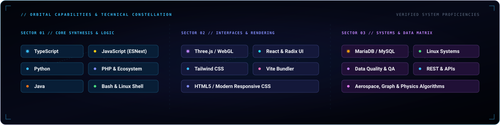

<!-- ==================== HERO OBSERVATORY ==================== -->

 

<!-- ==================== CELESTIAL DIVIDER ==================== -->

 

<!-- ==================== DEEP SPACE EXPEDITIONS ==================== -->

  
  

  
  

  
  

 

<!-- ==================== CELESTIAL DIVIDER ==================== -->

 

<!-- ==================== ORBITAL TECHNICAL CONSTELLATION ==================== -->

 

<!-- ==================== CELESTIAL DIVIDER ==================== -->

 

<!-- ==================== CELESTIAL TELEMETRY & STATS ==================== -->

 

<!-- ==================== CELESTIAL DIVIDER ==================== -->

 

<!-- ==================== TRANSMISSION FOOTER ==================== -->

